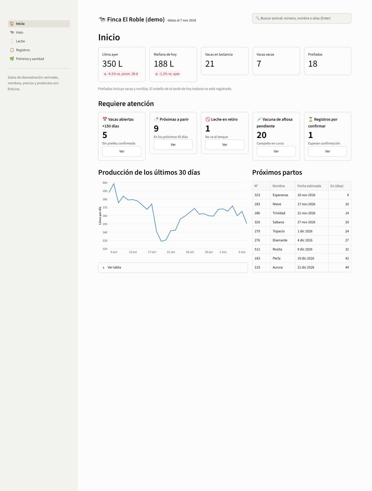
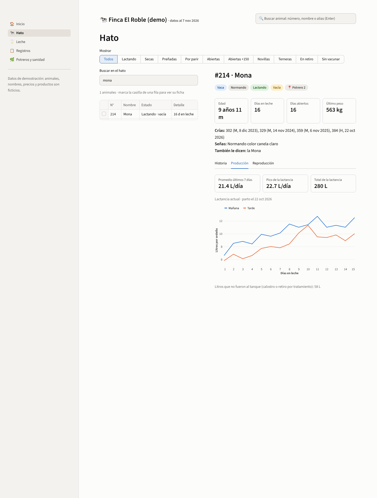
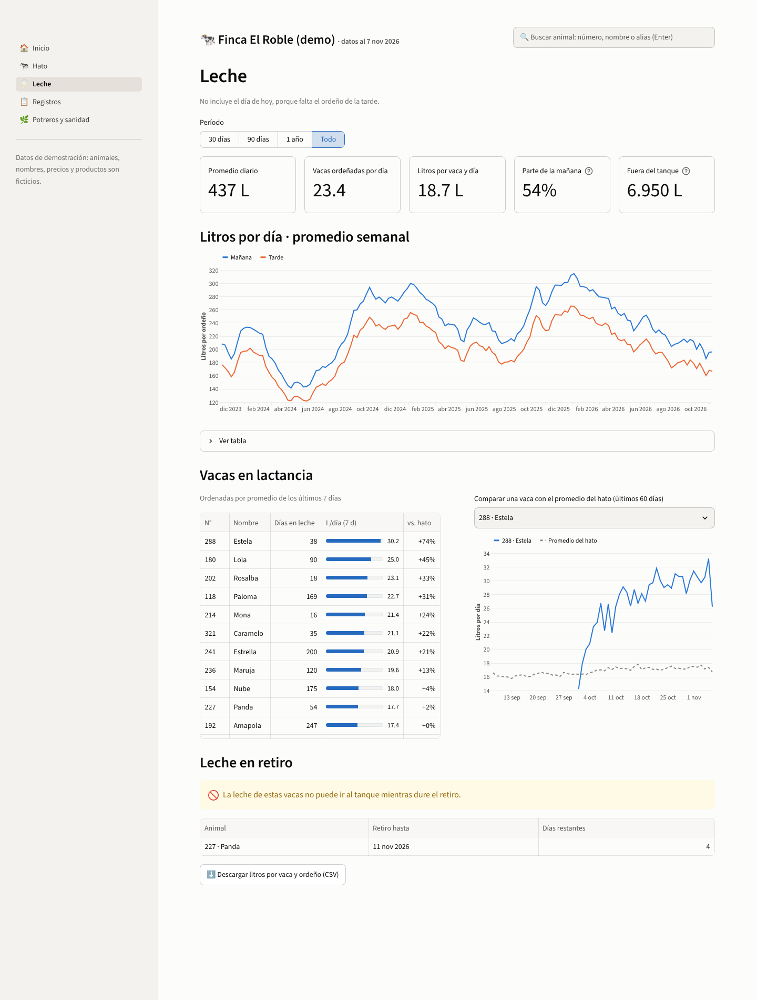
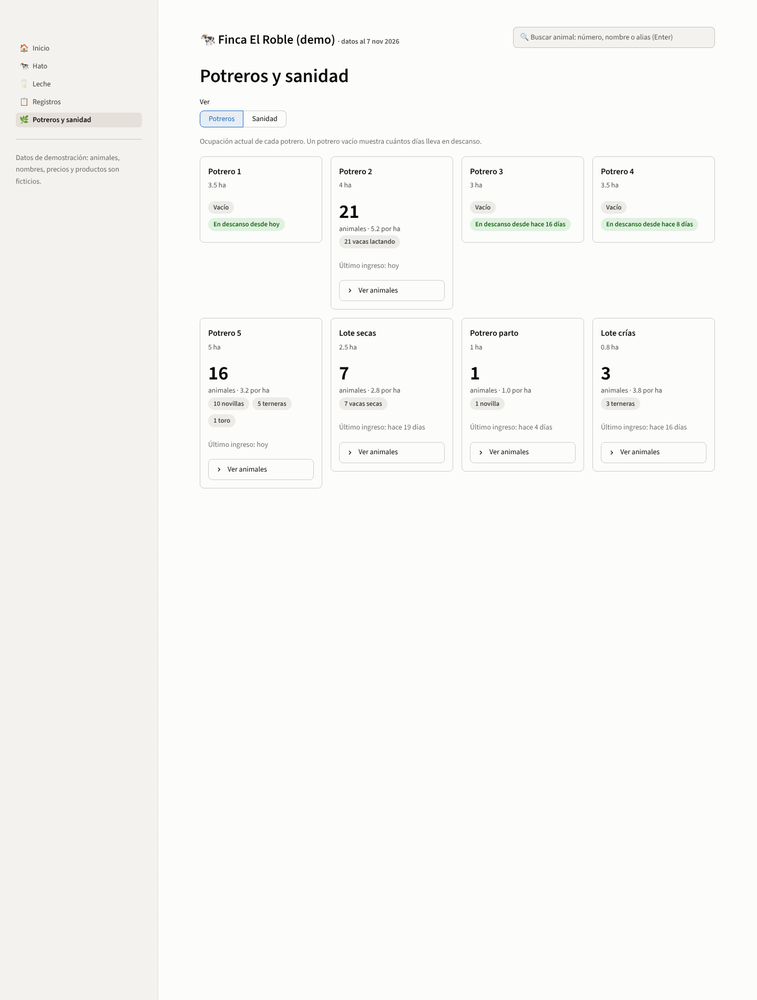

# Interfaz (Streamlit)

Interfaz web de **solo lectura** sobre `db/demo.db`, pensada para Chrome en computador. Todo se registra por chat (el agente); aquí se consulta.

## Cómo correrla

```bash
python3 -m venv .venv && source .venv/bin/activate
pip install -r requirements.txt
streamlit run app/main.py        # abre http://localhost:8501
```

Si `db/demo.db` no existe, la app la crea sola a partir de `data/demo/*.csv`.

## Secciones

| Sección | Para qué sirve |
|---|---|
| **Inicio** | Litros de ayer y de la mañana de hoy, conteo de vacas, cinco alertas con botón "Ver" (vacas abiertas +150 días, próximas a parir, leche en retiro, vacuna de aftosa pendiente, registros por confirmar), gráfica de 30 días y próximos partos |
| **Hato** | Lista con filtros rápidos y buscador; al marcar la casilla de una fila aparece la **ficha**: estado, genealogía y pestañas Historia, Producción (curva de lactancia por ordeño) y Reproducción |
| **Leche** | Período (30 días, 90 días, 1 año, todo), litros por ordeño de la mañana y de la tarde, ranking de vacas, comparación de una vaca con el promedio del hato, leche en retiro y descarga en CSV |
| **Registros** | Historial completo con filtros (fechas, tipo, estado, animal), eventos anulados y pendientes, descarga en CSV |
| **Potreros y sanidad** | Ocupación de cada potrero y días de descanso; avance de la campaña de aftosa, animales sin vacunar, campañas y tratamientos anteriores |

El **buscador de arriba** está en todas las páginas: acepta número, nombre, alias o señas ("oreja cortada"), sin tildes ni mayúsculas, y lleva directo al Hato.

## Estructura del código

```
app/
├── main.py                  # navegación, encabezado y buscador global
├── datos.py                 # consultas SQLite (solo lectura), filtros, textos de eventos
├── ui.py                    # estilo y gráficas (paleta azul/naranja validada)
└── paginas/                 # inicio, hato, leche, registros, potreros_sanidad
.streamlit/config.toml       # tema
```

## Decisiones de diseño

- **Solo lectura:** la conexión a SQLite se abre con `mode=ro`; la interfaz no puede modificar datos.
- **El estado se calcula** en las vistas de `schema_sqlite.sql`; la interfaz no guarda ni deriva nada por su cuenta.
- **Hoy = `config.fecha_demo`** (7 nov 2026), así el demo no cambia con el tiempo. Se excluye el día de hoy de las gráficas de leche porque falta el ordeño de la tarde.
- **Gráficas:** líneas de 2 px, leyenda cuando hay dos series, cruz y tooltip al pasar el mouse, y una tabla con los datos bajo cada gráfica. Colores validados con el validador de paletas (mañana = azul, tarde = naranja; referencia del hato = gris discontinuo).

## Capturas





